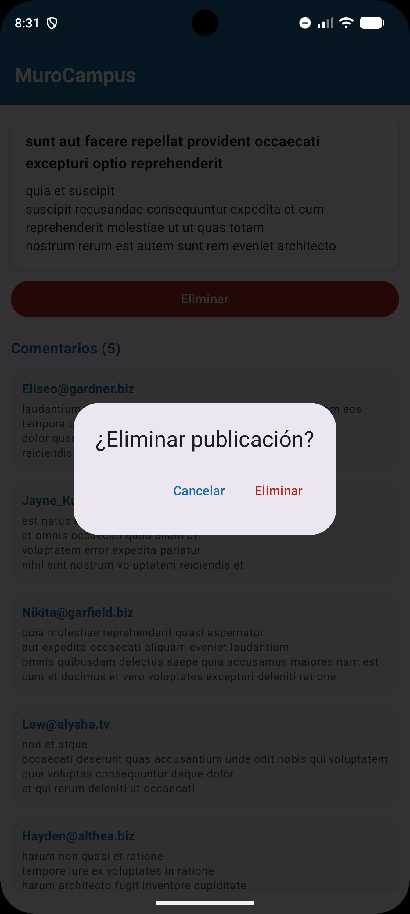
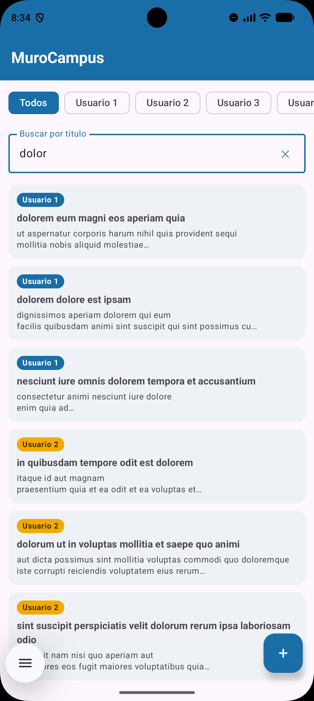
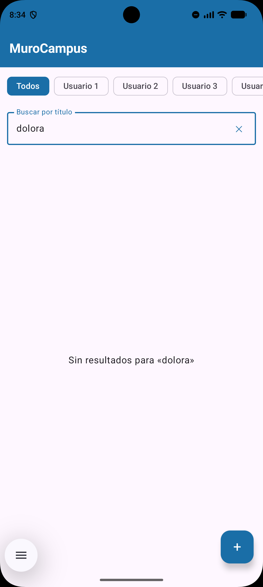
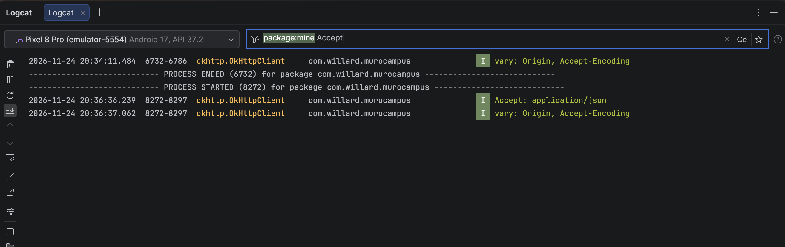

# PROMPTS.md · Fase 2 con IA (rama `mejora-ia`)

- **Herramienta:** Gemini en Android Studio (modo Agent)
- **Fecha:** 24/11/2026
- **Regla seguida:** la IA propone y yo decido. Revisé cada respuesta antes del commit: nada de Retrofit, Response ni HttpException en el ViewModel, y ninguna pantalla llama a la API.

| # | Prompt que escribí | Qué respondió Gemini | Qué cambié o descarté | Por qué |
|---|---|---|---|---|
| 1 | «Agrega la mejora "Borrar publicación": `@DELETE("posts/{id}")` con `Response<Unit>` en PostApi, `eliminar(id): Result<Unit>` en el Repository usando `llamar { }`, un StateFlow `eliminacion` en el ViewModel que quite el post de la lista sin volver a descargarla, y un botón Eliminar con AlertDialog en el detalle. El ViewModel no puede conocer Retrofit, Response ni HttpException.» | Modificó 5 archivos: el endpoint DELETE en `PostApi`, `eliminar()` en el Repository (si `isSuccessful` es falso lanza `HttpException` para que `llamar` lo convierta en `Result.failure`), `eliminacion` y `eliminar()` en el ViewModel (filtra la lista local), el botón rojo con diálogo de confirmación en `PantallaDetalle`, y un `LaunchedEffect` en `MainActivity` que vuelve a la lista al eliminar. | No cambié nada. Revisé el diff: el ViewModel solo usa `repo.eliminar()` y `mensajeDe()`, el `HttpException` quedó dentro del Repository y la pantalla solo llama a `vm.eliminar()`. | Cumple MVVM + Repository: `Response<Unit>` se revisa en la capa de datos, que es la única que conoce Retrofit. Como JSONPlaceholder no borra de verdad, quitar el post del estado local es la forma correcta de reflejar el cambio sin otra descarga. |
| 2 | «Agrega la mejora "Búsqueda por título" que filtre las publicaciones ya descargadas sin llamar a la red: `_busqueda` y `buscar()` en el ViewModel, un `listaVisible` hecho con `combine(_lista, _busqueda)` + `stateIn`, y un OutlinedTextField "Buscar por título" con botón ✕ en la lista. El filtrado va en el ViewModel, no en el Composable, y sin dependencias nuevas.» | Modificó 2 archivos. En el ViewModel creó `busqueda`, `buscar()` y `listaVisible`, que filtra por `title` ignorando mayúsculas y espacios y deja Cargando y Error sin tocar. En `PantallaLista` agregó el campo de búsqueda con ✕ (un TextButton, sin íconos), dibuja `listaVisible` y muestra "Sin resultados para «texto»" o "Sin publicaciones" según el caso. | No cambié nada. Comprobé que `lista` sigue existiendo, que el filtro se calcula en el ViewModel y que no agregó la dependencia de material-icons. | Usar `combine` deriva la lista visible de dos fuentes (datos y texto) sin duplicar estado: la búsqueda funciona junto con los chips de usuario y con la eliminación, porque las tres modifican o leen la misma `_lista`. Como no usa la red, el filtrado es instantáneo. |
| 3 | «Agrega la mejora "Encabezado con interceptor": crea `EncabezadosInterceptor` (implementa `okhttp3.Interceptor`) que agregue `Accept: application/json` a todas las peticiones con `header()`, y regístralo en `RetrofitClient` antes del `HttpLoggingInterceptor`. Solo cambia la capa `data/remote`.» | Creó `data/remote/EncabezadosInterceptor.kt`, que copia la petición con `newBuilder().header("Accept", "application/json")` y la envía con `chain.proceed()`, y lo registró en el `OkHttpClient.Builder` antes del logging. Explicó que `header()` reemplaza el valor si ya existe y que `addHeader()` lo duplicaría. | No cambié nada. Verifiqué que el Repository, el ViewModel y las pantallas no se tocaron y que el Logcat muestra `Accept: application/json` en cada petición. | El orden de los interceptores importa: si el de logging va primero, registra la petición antes de que tenga el encabezado y no se vería en Logcat. Centralizar los encabezados en un interceptor evita repetir `@Headers` en cada función de la API, y es el mismo lugar donde iría un token de autenticación en un servicio real. |

## Capturas de evidencia

| Borrar (confirmación) | Búsqueda | Sin resultados |
|:---:|:---:|:---:|
|  |  |  |

**Interceptor: encabezado `Accept` en Logcat**


## Prompts completos

### 1 · Borrar publicación

```
Trabajo en la app Android MuroCampus (Kotlin, Jetpack Compose, Retrofit, kotlinx.serialization) con arquitectura MVVM + Repository. Paquete: com.willard.murocampus. La API es https://jsonplaceholder.typicode.com/.

Quiero agregar la mejora "Borrar publicación":
1. En data/remote/PostApi.kt agrega: @DELETE("posts/{id}") suspend fun eliminar(@Path("id") id: Int): Response<Unit>. La ruta no debe empezar con "/".
2. En data/PostRepository.kt agrega a la interface PostRepository: suspend fun eliminar(id: Int): Result<Unit>. Impleméntala en PostRepositoryRemote usando la función privada llamar { } que ya existe: si response.isSuccessful devuelve Unit; si no, lanza HttpException(response) para que llamar lo convierta en Result.failure.
3. En viewmodel/PostsViewModel.kt agrega un StateFlow<UiState<Unit>?> llamado eliminacion (null = no se ha intentado), una función eliminar(id: Int) que use viewModelScope.launch, ponga Cargando, llame a repo.eliminar(id) y, si funciona, quite esa publicación del estado actual de la lista (_lista) sin volver a descargarla; si falla, use Error(mensajeDe(it)). Agrega también reiniciarEliminacion().
4. En ui/PantallaDetalle.kt agrega debajo de la tarjeta de la publicación un botón "Eliminar" con color de error que primero muestre un AlertDialog de confirmación ("¿Eliminar publicación?" con botones "Eliminar" y "Cancelar"). Mientras se elimina, el botón queda deshabilitado. Si falla, muestra el mensaje de error debajo del botón.
5. En MainActivity.kt, cuando eliminacion pase a Exito, vuelve a la lista (idSeleccionado = null) y llama a vm.reiniciarEliminacion(). Al abrir un detalle también reinicia la eliminación.

Reglas obligatorias:
- El ViewModel NO puede importar ni usar Retrofit, Response, HttpException, PostApi ni Context. Solo conoce la interface PostRepository.
- Ningún Composable llama a la API ni al Repository; solo al ViewModel.
- No uses GlobalScope ni catch vacíos. Respeta que el Repository relanza CancellationException.
- No cambies los nombres ni el comportamiento de lo que ya existe (listar, detalle, comentarios, porUsuario, crear, filtrar, publicar).

Al terminar, dame un resumen corto con: los archivos que cambiaste, qué hace cada cambio y cómo probarlo en el emulador.
```

### 2 · Búsqueda por título

```
Sigo con la app MuroCampus (Kotlin, Jetpack Compose, MVVM + Repository, paquete com.willard.murocampus).

Quiero agregar la mejora "Búsqueda por título" que filtre las publicaciones YA descargadas, sin hacer nuevas llamadas a la red:
1. En viewmodel/PostsViewModel.kt agrega un MutableStateFlow<String> privado _busqueda (empieza en ""), su versión pública busqueda: StateFlow<String> y una función buscar(texto: String).
2. En el mismo ViewModel crea listaVisible: StateFlow<UiState<List<Post>>> usando combine(_lista, _busqueda) y stateIn(viewModelScope, SharingStarted.WhileSubscribed(5000), UiState.Cargando). Si _lista es Exito, filtra los posts cuyo title contenga el texto buscado (ignorando mayúsculas y espacios al inicio/fin); si es Cargando o Error, déjalo igual.
3. En ui/PantallaLista.kt agrega un OutlinedTextField con label "Buscar por título", singleLine, entre la fila de chips y la lista. Usa vm.busqueda y vm.buscar(). Si hay texto, muestra un trailingIcon con un TextButton "✕" que limpie la búsqueda. La lista debe dibujarse con vm.listaVisible en lugar de vm.lista.
4. Si la búsqueda no encuentra nada, muestra "Sin resultados para «texto»". Si la lista viene vacía sin búsqueda, mantén "Sin publicaciones".
5. La búsqueda debe funcionar junto con el filtro de usuario (chips) y con la eliminación que ya existe.

Reglas obligatorias:
- El filtrado se hace en el ViewModel, no en el Composable.
- El ViewModel NO puede importar Retrofit, Response, HttpException, PostApi ni Context.
- No agregues dependencias nuevas (no uses material-icons).
- No cambies el comportamiento existente de cargar, filtrar, abrir, publicar ni eliminar; vm.lista debe seguir existiendo.

Al terminar, dame un resumen corto con: los archivos que cambiaste, qué hace cada cambio y cómo probarlo en el emulador.
```

## Qué aprendimos

- (Por completar)
