# MuroCampus

App Android que consume un **servicio web REST** ([JSONPlaceholder](https://jsonplaceholder.typicode.com/)): lista publicaciones, muestra el detalle con sus comentarios, filtra por usuario y crea una publicación nueva. Se comporta bien sin internet: nunca se cierra y muestra un mensaje con el botón **Reintentar**.

**Laboratorio 09 · Servicios Web y plataforma REST** – Programación en Móviles, 4.º ciclo, Diseño y Desarrollo de Software (Tecsup).
**Autor:** Guillermo Willard Castillo

## Tecnologías

| Pieza | Para qué sirve |
|---|---|
| Kotlin 2.2.10 + Jetpack Compose (Material 3) | Interfaz declarativa |
| Retrofit 2.11.0 | Convierte la interface `PostApi` en llamadas HTTP |
| OkHttp 4.12.0 + HttpLoggingInterceptor | Conexión y registro del tráfico en Logcat |
| kotlinx.serialization 1.9.0 | Convierte el JSON en `data class` |
| ViewModel + StateFlow + corrutinas | Estado de pantalla que sobrevive a la rotación |

## Estructura de paquetes

```
com.willard.murocampus/
├── MainActivity.kt              Scaffold, barra MuroCampus, navegación (lista / detalle / crear) y FAB +
├── model/
│   └── Modelos.kt               Post, Comentario, NuevoPost (+ Usuario del ejemplo)
├── data/
│   ├── remote/
│   │   ├── PostApi.kt           Interface de Retrofit: @GET, @POST, @Path, @Query, @Body
│   │   └── RetrofitClient.kt    object con Retrofit creado una sola vez (by lazy)
│   ├── PostRepository.kt        interface + PostRepositoryRemote (devuelve Result)
│   └── Errores.kt               mensajeDe(): traduce la excepción a un mensaje
├── viewmodel/
│   ├── UiState.kt               Cargando / Exito / Error
│   ├── PostsViewModel.kt        lista, detalle, filtro y crear
│   └── PostsViewModelFactory.kt Recibe el Repository por constructor
└── ui/
    ├── Componentes.kt           TarjetaPost, Cargando, ErrorConReintento
    ├── PantallaLista.kt         Chips de filtro + LazyColumn
    ├── PantallaDetalle.kt       Publicación + Comentarios (N)
    ├── PantallaCrear.kt         Formulario con validación
    └── theme/                   Colores azules del tema
```

## Arquitectura MVVM + Repository

```
View (PantallaLista, PantallaDetalle, PantallaCrear)
   |  eventos: cargar, abrir, filtrar, publicar        ^  collectAsStateWithLifecycle()
   v                                                    |
ViewModel (PostsViewModel) --- StateFlow<UiState> (Cargando / Exito / Error) --->
   |  viewModelScope.launch
   v
PostRepository (interface)  <-- devuelve Result<...>
   -> PostRepositoryRemote   (captura IOException, HttpException, SerializationException)
   |
   v
PostApi (Retrofit) --- OkHttp ---> https://jsonplaceholder.typicode.com/
```

| Capa | Conoce a | No debe |
|---|---|---|
| View (`ui/`) | Solo a su ViewModel | Llamar a Retrofit ni conocer PostApi |
| ViewModel | Solo a la interface `PostRepository` | Conocer Retrofit, HttpException ni Context |
| Repository | PostApi y las excepciones de red | Dejar escapar excepciones: devuelve `Result` |
| data/remote | Retrofit, OkHttp y el JSON | Guardar estado de pantalla |

## API utilizada

| Para... | Verbo y ruta | Función en `PostApi` |
|---|---|---|
| Listar publicaciones | `GET posts` | `listar()` |
| Ver una publicación | `GET posts/{id}` | `detalle(@Path("id") id)` |
| Ver sus comentarios | `GET posts/{id}/comments` | `comentarios(@Path("id") id)` |
| Filtrar por usuario | `GET posts?userId=2` | `porUsuario(@Query("userId") userId)` |
| Crear una publicación | `POST posts` | `crear(@Body nuevo)` |

> Los textos de las publicaciones vienen en latín de relleno (*lorem ipsum*) porque así los entrega JSONPlaceholder.

## Capturas

| Lista | Detalle | Filtro (Usuario 2) |
|:---:|:---:|:---:|
| 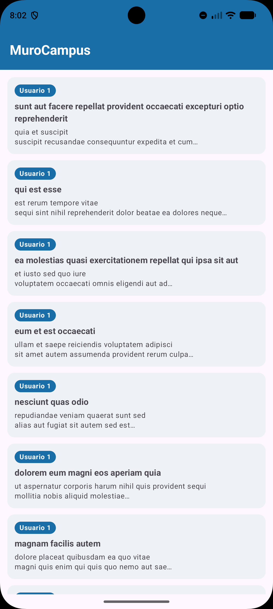 | 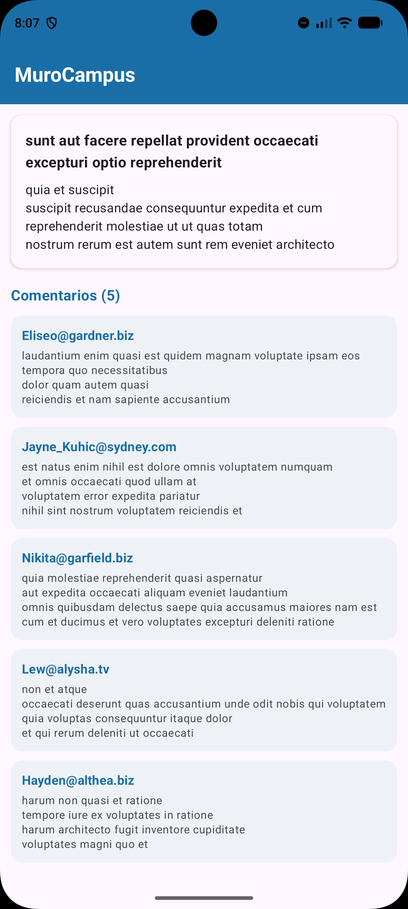 | 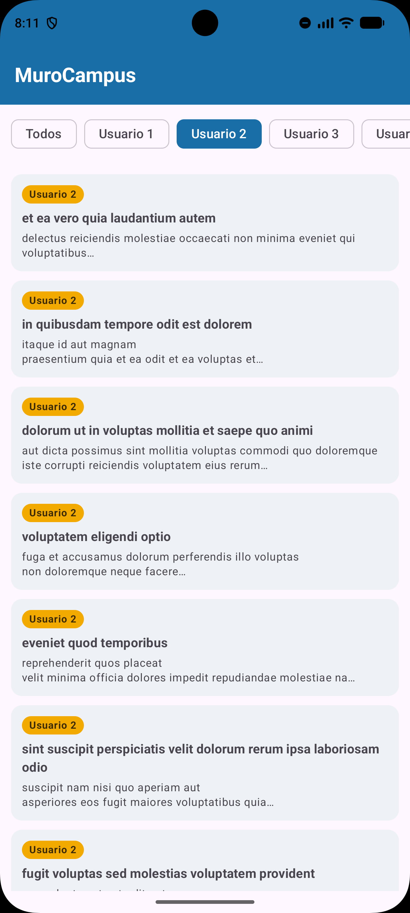 |

| Crear | Error de conexión |
|:---:|:---:|
| 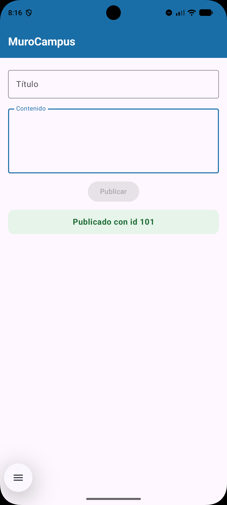 |  |

<details>
<summary>Más evidencias (Logcat, cargando, rotación y errores)</summary>

| Cargando | Lista rotada | Detalle sin conexión |
|:---:|:---:|:---:|
| 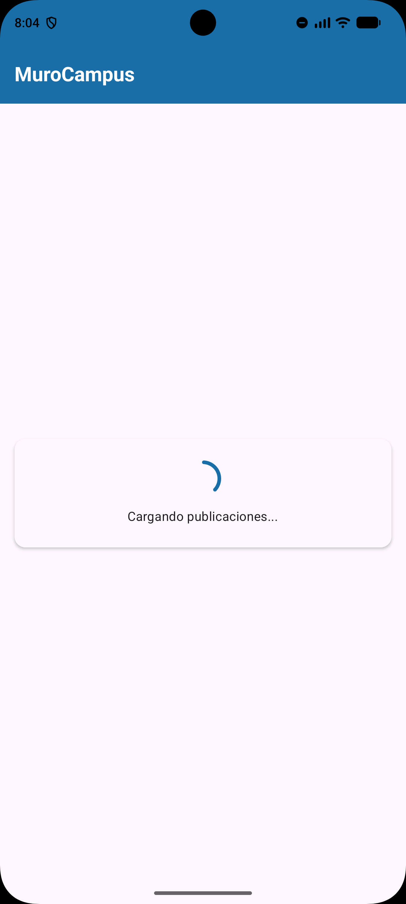 | 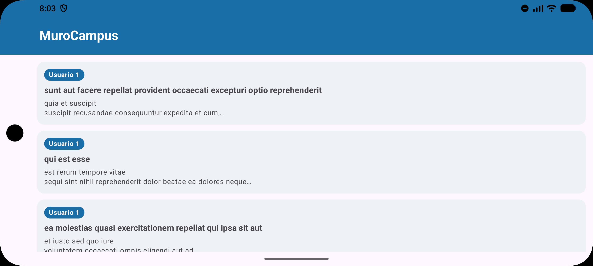 | 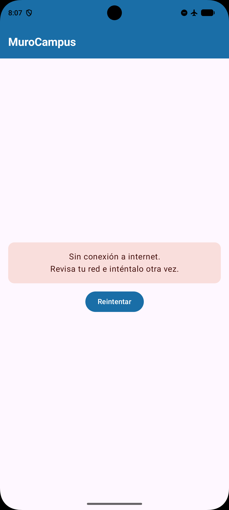 |

| Filtro "Todos" | Formulario | Error 404 | Respuesta inesperada |
|:---:|:---:|:---:|:---:|
| 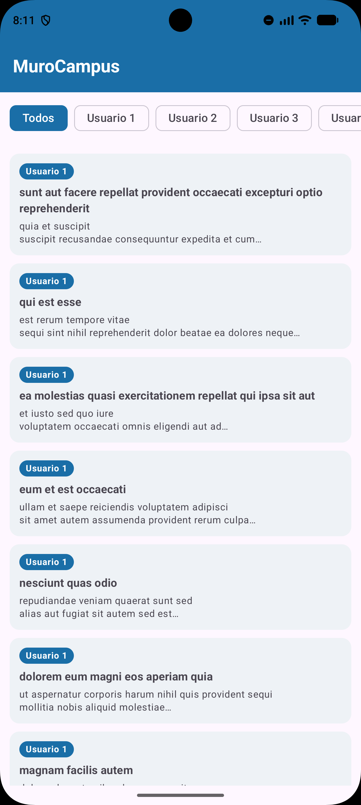 | 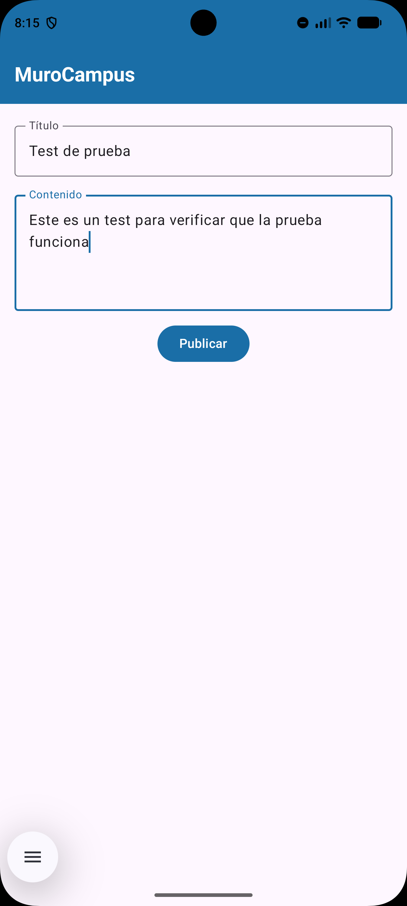 | 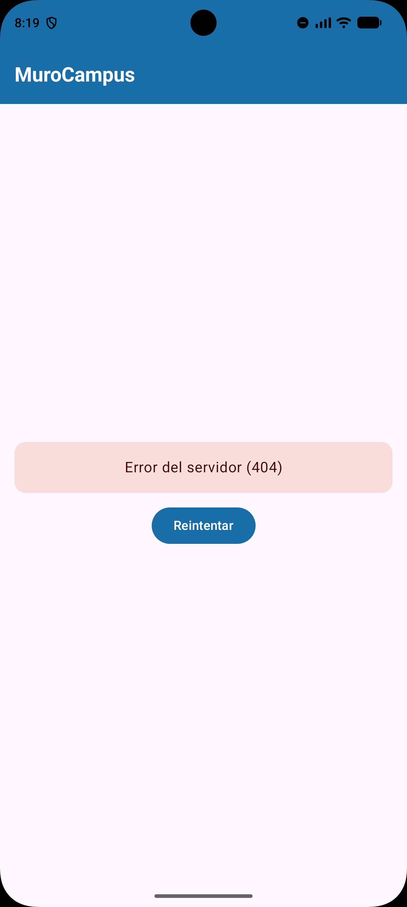 | 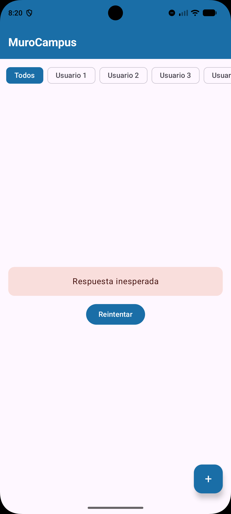 |

**Logcat: prueba de Retrofit (Paso 4)**
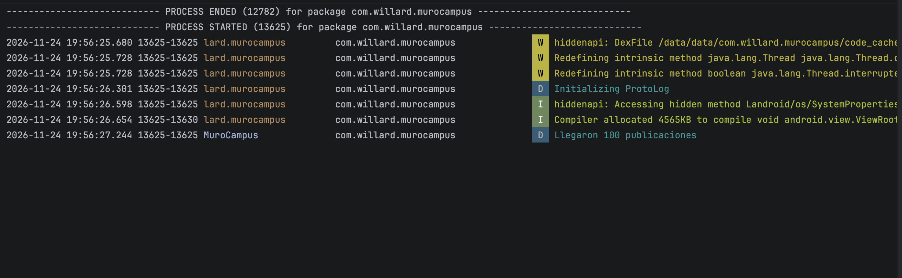

**Logcat: filtro con @Query (`posts?userId=2`)**
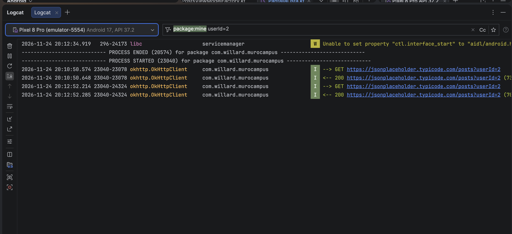

**Logcat: POST con respuesta 201**
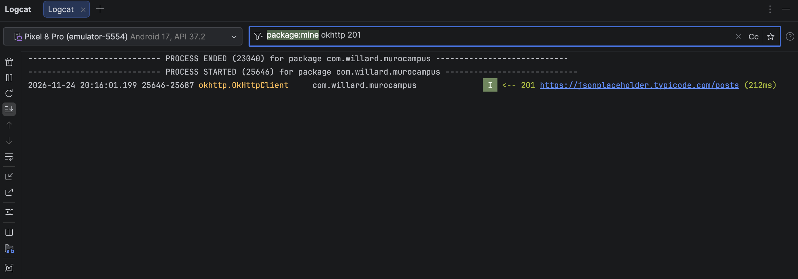

</details>

## Pruebas de fallas (Paso 10)

| Prueba | Cómo se provocó | Resultado | OK |
|---|---|---|:---:|
| Sin internet | Modo avión y abrir la app | **Sin conexión a internet** y botón **Reintentar** | ✅ |
| Reintentar | Quitar el modo avión y pulsar Reintentar | Carga la lista | ✅ |
| Recurso inexistente | `detalle(9999)` temporal en el Repository | **Error del servidor (404)** | ✅ |
| JSON inesperado | Quitar `name` de `Comentario` (temporal) | Funciona gracias a `ignoreUnknownKeys` | ✅ |
| JSON inesperado | Agregar `autor` a `Post`, campo que no llega (temporal) | **Respuesta inesperada** | ✅ |
| Cancelación | Abrir el detalle y volver rápido | Sin errores en Logcat | ✅ |
| Lista y detalle | Abrir varias publicaciones | Siempre 5 comentarios | ✅ |
| Filtro | Elegir cada usuario | Siempre 10 publicaciones | ✅ |
| Crear | Enviar una publicación | **Publicado con id 101** | ✅ |
| Código | Revisar `viewmodel/` | No hay Retrofit, PostApi ni HttpException | ✅ |

Todos los cambios temporales se deshicieron antes del commit.

## Decisiones tomadas

- **Proyecto base:** el docente no entregó el proyecto base, así que se creó desde cero. Cada archivo [E] se agregó en el primer commit donde podía compilar: `UiState` y el Factory en el Paso 6, y `Usuario` en `Modelos.kt` en el Paso 2.
- **Paquete:** `com.willard.murocampus` en lugar de `com.tecsup.murocampus`.
- **Versiones:** el plugin de serialización usa la versión del Kotlin del proyecto (2.2.10) mediante el catálogo `libs.versions.toml`, como pide el contrato. `kotlinx-serialization-json` 1.9.0 y `lifecycle-runtime-compose` 2.11.0 son las compatibles con este proyecto.
- **`mensajeDe()` en `data/Errores.kt`:** la guía la coloca en `viewmodel/UiState.kt`, pero usa `HttpException`, y la regla del lab prohíbe Retrofit y HttpException en el ViewModel. Moverla a `data/` deja la carpeta `viewmodel/` sin rastro de Retrofit.
- **Factory con el Repository por constructor:** `MainActivity` arma `PostRepositoryRemote(RetrofitClient.api)`, así el ViewModel solo conoce la interface.

## Para pensar

**1. ¿Qué diferencia hay entre GET y POST? ¿Por qué `crear` lleva `@Body` y `porUsuario` lleva `@Query`?**
GET **lee** un recurso sin modificar nada en el servidor y puede repetirse sin efectos. POST **crea** un recurso nuevo y cambia el estado del servidor. `crear` lleva `@Body` porque la publicación nueva es un objeto completo (`NuevoPost`) que viaja como JSON en el **cuerpo** de la petición. `porUsuario` lleva `@Query` porque solo agrega un filtro a la URL (`posts?userId=2`): no envía datos para guardar, solo indica qué publicaciones queremos leer.

**2. ¿Por qué la ruta es `"posts"` y no `"/posts"`?**
Retrofit combina la ruta con la `baseUrl` como lo hace un navegador con un enlace. Una ruta **relativa** (`posts`) se agrega al final de la base. Una ruta que empieza con `/` es **absoluta**: reemplaza todo el camino de la base y deja solo el dominio. Con esta base no se nota, porque termina en el dominio, pero si la base fuera `https://servidor.com/api/v1/`, la ruta `/posts` iría a `https://servidor.com/posts` y se perdería `api/v1/`.

**3. ¿Por qué el Repository devuelve `Result` en vez de dejar que la excepción llegue al ViewModel?**
Porque así el error se vuelve un **valor** que el ViewModel maneja con `onSuccess` y `onFailure`, sin `try/catch` y sin conocer `IOException` ni `HttpException`, que son detalles de Retrofit. Si una excepción escapara sin capturar, la app se cerraría. Además, si mañana los datos vienen de Room en lugar de la red, el ViewModel no cambia.

**4. ¿Qué pasa si olvidas el permiso INTERNET? ¿Y si olvidas `ignoreUnknownKeys` y el servidor agrega un campo nuevo?**
Sin el permiso INTERNET la app **compila igual**, pero toda llamada falla con un error de red (`SecurityException` o `UnknownHostException`) aunque el teléfono tenga conexión. Sin `ignoreUnknownKeys`, kotlinx.serialization es estricto: cuando el servidor agrega un campo que la `data class` no tiene, lanza `SerializationException` y la app muestra **Respuesta inesperada**. Con esa opción, los campos desconocidos se ignoran y la app sigue funcionando aunque la API crezca.

**5. ¿Por qué la pantalla de lista usa un `when` sobre `UiState` y no un `if` con tres variables?**
Con tres variables (`cargando`, `datos`, `error`) pueden aparecer combinaciones imposibles, como cargando y con error a la vez, y hay que acordarse de limpiarlas en el orden correcto. Un `sealed interface` garantiza que la pantalla está en **un solo estado a la vez**. Además, el `when` es exhaustivo: el compilador obliga a dibujar los tres casos, y si mañana se agrega un estado nuevo, avisa dónde falta manejarlo.

**6. JSONPlaceholder no guarda los POST. ¿Cómo cambiaría tu app si usaras un servicio real?**
Después de un POST exitoso, la publicación nueva sí aparecería al recargar la lista. Habría que **refrescar la lista** o agregar el `Post` devuelto al estado sin volver a descargarlo. Con un servicio real también haría falta autenticación (un token en un Interceptor de OkHttp), validar los errores 400 y 422 que devuelve el servidor, evitar envíos duplicados mientras se publica y tal vez guardar una copia local con Room. Gracias a la interface `PostRepository`, todos estos cambios quedarían en la capa de datos y las pantallas casi no cambiarían.

## Cómo ejecutar

1. Abrir el proyecto en Android Studio y hacer **Sync Now**.
2. Ejecutar en un emulador o celular con internet (API 24 o superior).
3. Para ver el tráfico HTTP: en Logcat, filtrar con `package:mine okhttp`.
